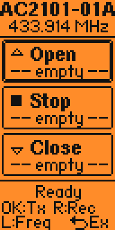
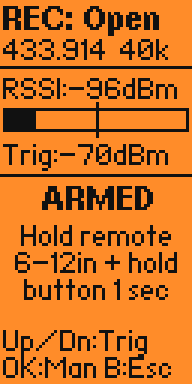

# AC2101 Curtain Remote (Flipper Zero)

40 kBaud 2-FSK RF capture and remote control app for the Flipper Zero, built for **AC2101-01A** curtain/blind remotes (commonly paired with Allesin / Sunfree M130 / A-OK motorized blinds operating around `433.914 MHz`).

> **Note:** No personal `.sub` capture files are included in this repository. Use the built-in capture screen on your Flipper Zero to record your own remote's `Open`, `Stop`, and `Close` buttons directly to `/ext/subghz/AC2101/`.

## Screenshots

| Remote Screen | Capture Screen (Armed) |
| :---: | :---: |
|  |  |

## Why Stock `Read RAW` Misses This Remote

Flipper Zero's built-in `Sub-GHz → Read RAW` cannot capture 40 kBaud (`25 µs` symbol duration) bursts cleanly:

1. `SubGhzWorker` applies a default **`30 µs` short-pulse filter** (`filter_duration = 30`), merging single-bit `25 µs` pulses into neighboring levels.
2. The RAW decoder (`raw.c`) enforces **`te_short = 50`** (`if(duration > 50)`), dropping both `25 µs` (1-symbol) and `50 µs` (2-symbol) pulses along with adjacent same-polarity transitions.
3. `furi_hal_subghz_start_async_rx` uses a `16 µs` hardware TIM2 input capture filter (`FDIV32_N8`).

### How This App Solves It

- Configures the CC1101 with the **`FSK_40K_19K`** preset (`39.970 kBaud`, `±19.043 kHz` deviation, `203.12 kHz` RX bandwidth) tuned to **`433.914 MHz`** (toggleable to `433.920 MHz`).
- Bypasses `SubGhzWorker` and `raw.c` completely using `subghz_devices_start_async_rx` directly, lowering TIM2's `CH2` hardware input filter to **`12 µs`** (`LL_TIM_IC_FILTER_FDIV32_N6`) so `25 µs` pulses pass cleanly.
- Uses a `2,048`-sample pre-trigger ring buffer (`4 ms` rewind) gated by a live RSSI trigger so the mandatory `~165 ms` wake-up preamble and all repeating frames (up to `22,000` pulses) are captured intact.
- Saves standard Flipper RAW `.sub` files to `/ext/subghz/AC2101/{Open,Stop,Close}.sub` and replays complete bursts directly from RAM via DMA TX (`subghz_devices_start_async_tx`).

## Controls

### Remote Screen
- **Up / Down:** Select `Open`, `Stop`, or `Close`
- **OK:** Transmit the selected command (or enter Capture if the slot is empty)
- **Right:** Record / re-record the selected command
- **Left:** Toggle frequency between `433.914 MHz` and `433.920 MHz`
- **Back:** Exit

### Capture Screen
- **Auto-trigger:** Hold your AC2101-01A remote 6–12 inches from the Flipper's antenna and press & hold the button for 1 full second
- **Up / Down:** Adjust RSSI trigger threshold (`-85 dBm` to `-50 dBm`, default `-70 dBm`)
- **OK:** Manual start / stop override
- **Back:** Cancel and return

## Build & Install

Requires [`ufbt`](https://pypi.org/project/ufbt/) (tested with Momentum `mntm-012`, Target `7`, API `87.1`):

```bash
ufbt
```

Copy `dist/ac2101_curtain_remote.fap` to `/ext/apps/Sub-GHz/ac2101_curtain_remote.fap` on your Flipper Zero microSD card (launch via **Apps → Sub-GHz → AC2101 Curtain**).
